# Secure AWS VPC Infrastructure

## Project Overview

This project demonstrates the design and implementation of a segmented AWS network using Amazon VPC.

I created a custom VPC with public and private subnets across multiple Availability Zones, dedicated route tables, an Internet Gateway, NAT Gateway, security groups, and EC2 workloads.

The architecture separates internet-facing resources from private application resources and applies controlled network access using routing and security-group rules.

## Architecture

## Architecture Design

- VPC: `10.0.0.0/16`
- Public Subnet AZ1: `10.0.1.0/24`
- Public Subnet AZ2: `10.0.2.0/24`
- Private Subnet AZ1: `10.0.11.0/24`
- Private Subnet AZ2: `10.0.12.0/24`
- Internet Gateway for public internet connectivity
- NAT Gateway for private outbound internet access
- Separate public and private route tables
- Public and private EC2 workloads
- Security groups controlling access between resources

## AWS Services Used

- Amazon VPC
- Amazon EC2
- Internet Gateway
- NAT Gateway
- Elastic IP
- Route Tables
- Security Groups
- Public and Private Subnets

## Security Concepts Demonstrated

- Network segmentation
- Public and private subnet design
- Least-privilege network access
- Security-group-to-security-group access
- Controlled internet routing
- Private resource isolation
- Multi-Availability Zone network design
- Restricting SSH access to a trusted administrator IP

## Implementation

### 1. Created the Custom VPC

I created a custom VPC using the CIDR range `10.0.0.0/16`.

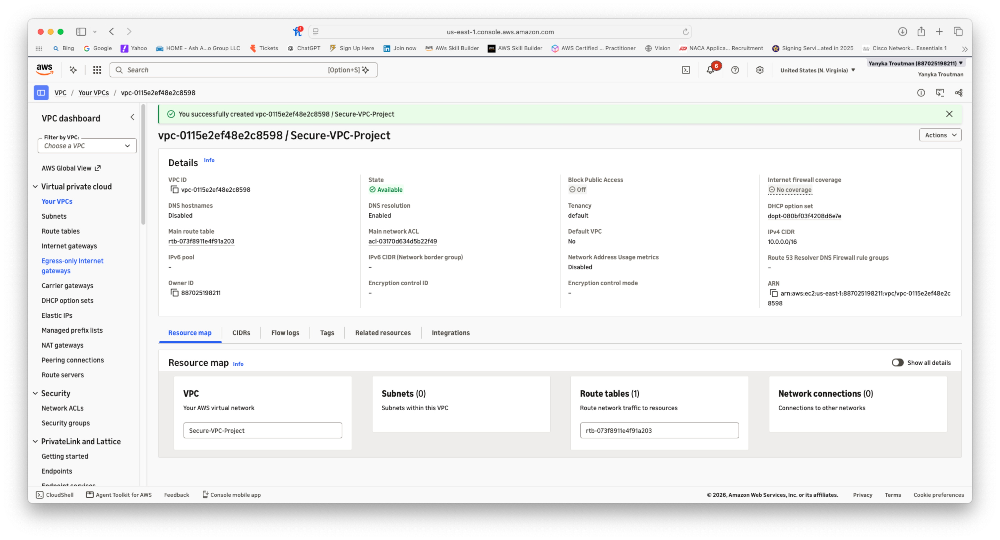

### 2. Created Public and Private Subnets

I created two public and two private subnets across two Availability Zones.

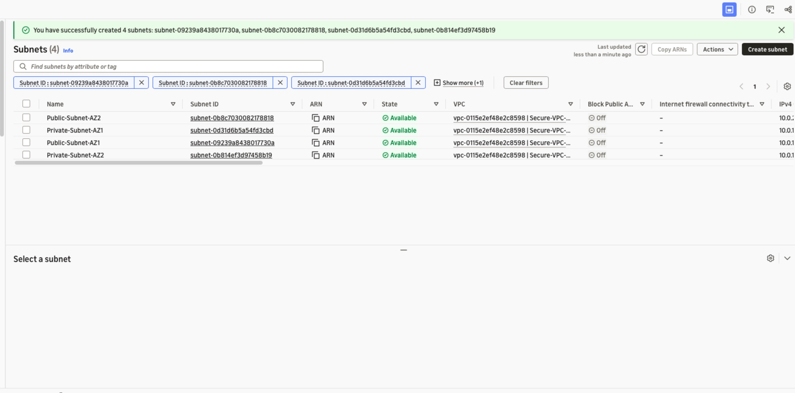

### 3. Configured Public Subnet Addressing

Public subnets were configured to support public IPv4 assignment for internet-facing resources.

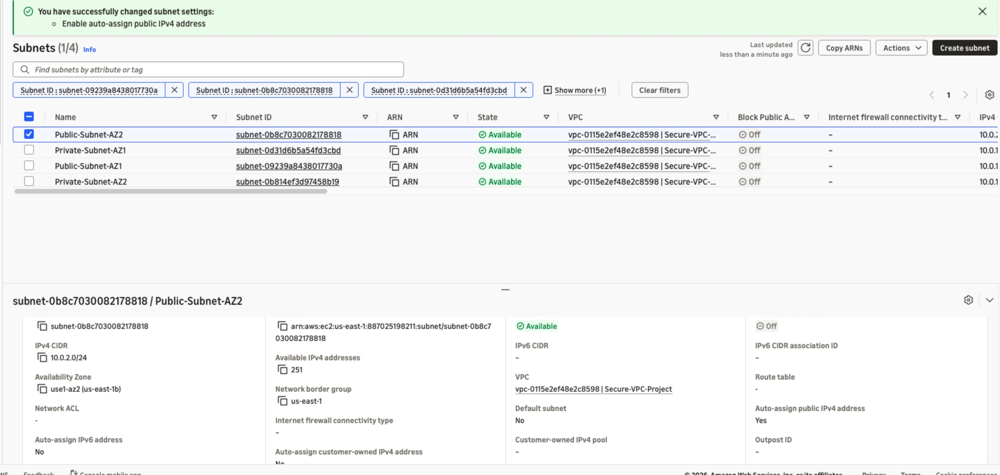

### 4. Attached the Internet Gateway

An Internet Gateway was attached to the VPC to provide internet connectivity for public resources.

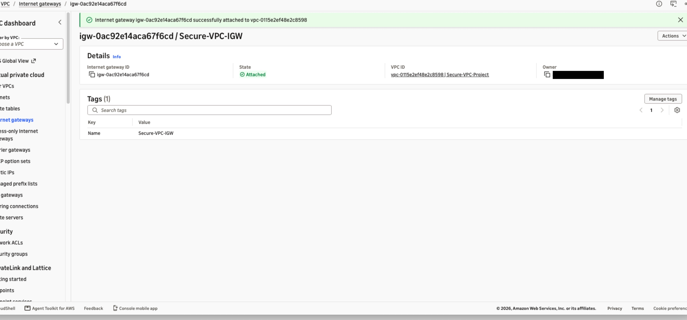

### 5. Configured Public Routing

The public route table included a default route to the Internet Gateway.

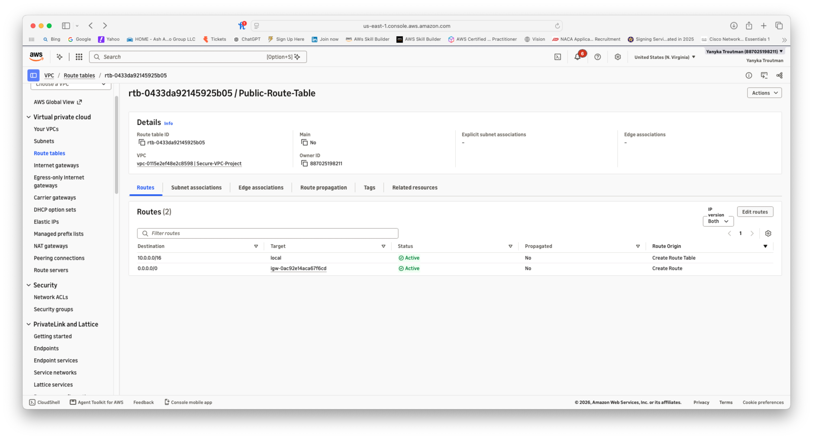

### 6. Associated Public Subnets

The public subnets were associated with the public route table.

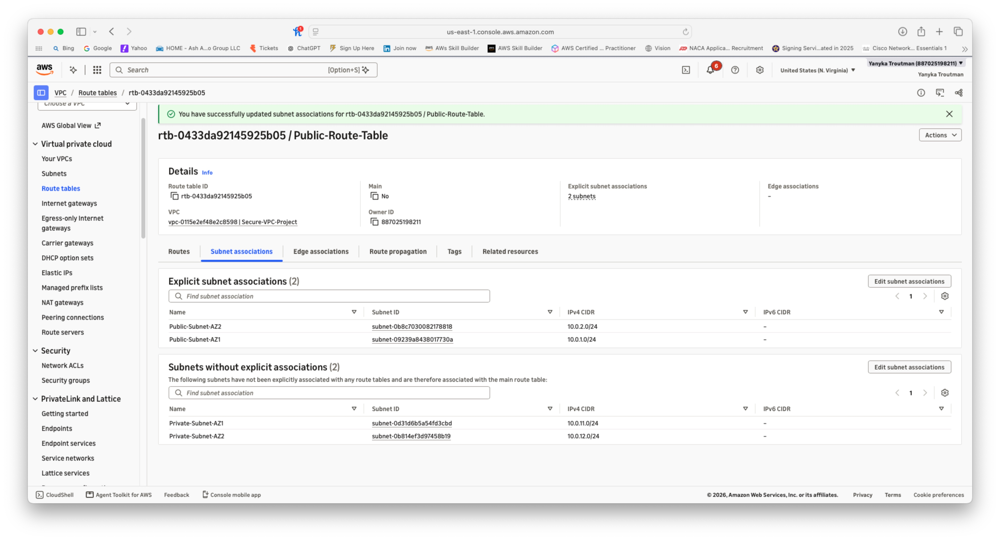

### 7. Configured Private Routing

The private subnets were associated with a separate private route table.

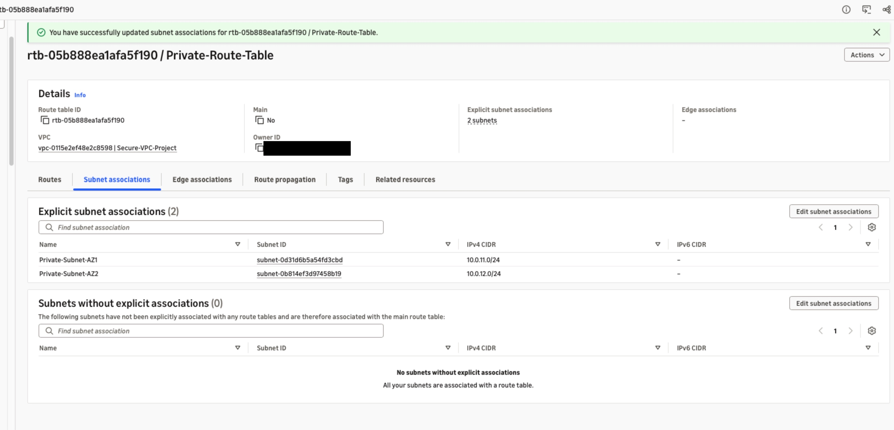

### 8. Configured the Public Security Group

The public web security group allowed SSH from my trusted IP and HTTP from the internet.

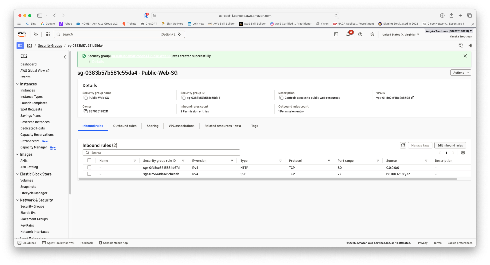

### 9. Configured the Private Security Group

The private security group restricted access to trusted resources and did not expose the private server directly to the internet.

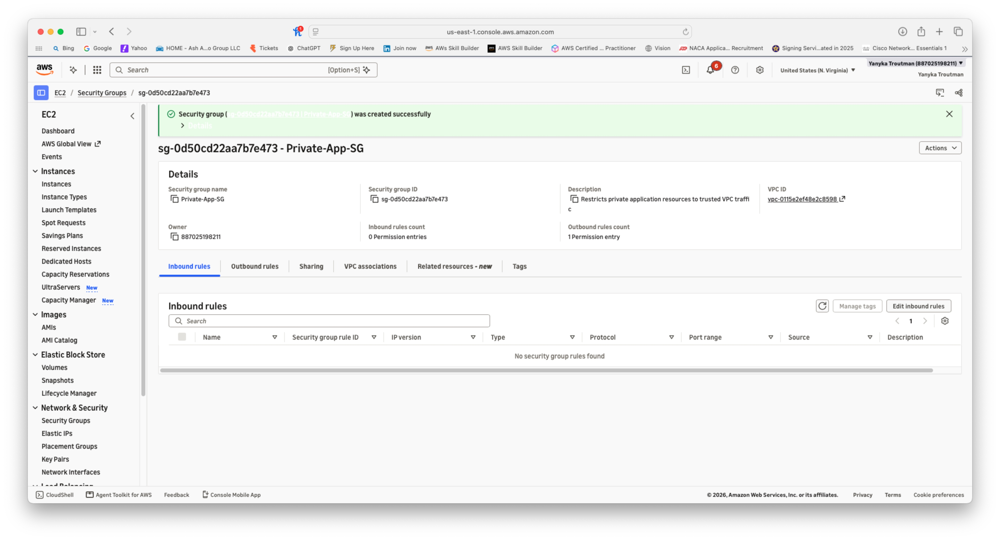

### 10. Deployed a Public EC2 Instance

A public EC2 instance was deployed in Public Subnet AZ1.

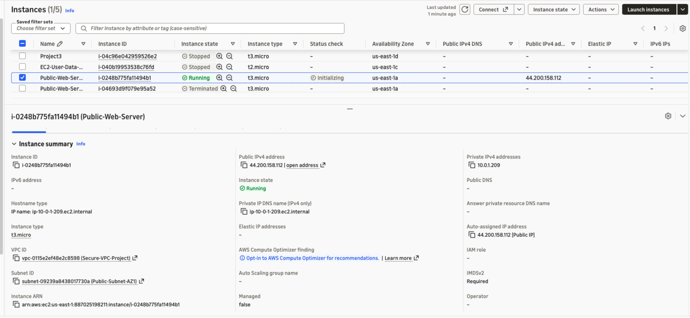

### 11. Verified Public Connectivity

I connected to the public EC2 instance using SSH and verified its network configuration.

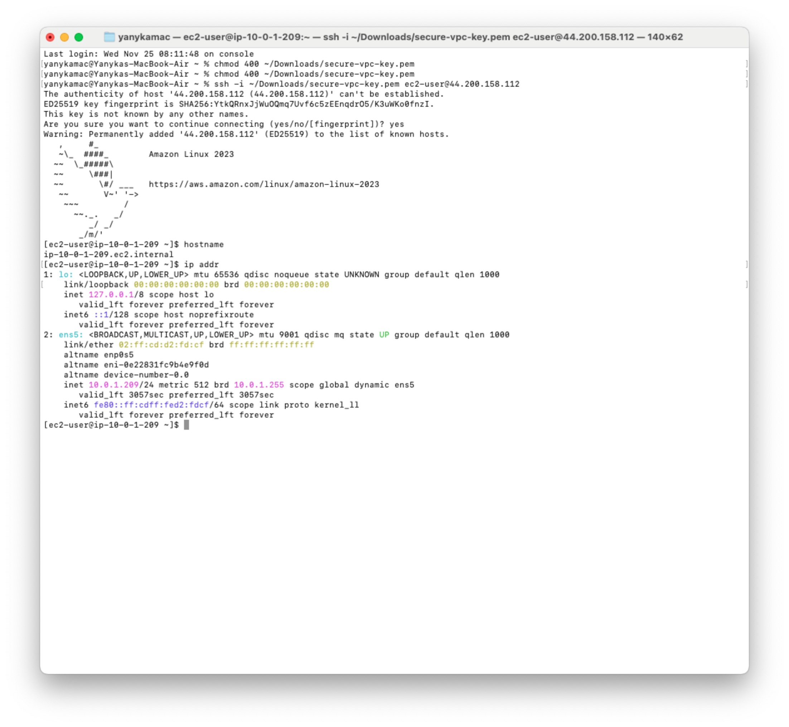

### 12. Deployed a Private EC2 Instance

A private EC2 instance was deployed without a public IPv4 address.

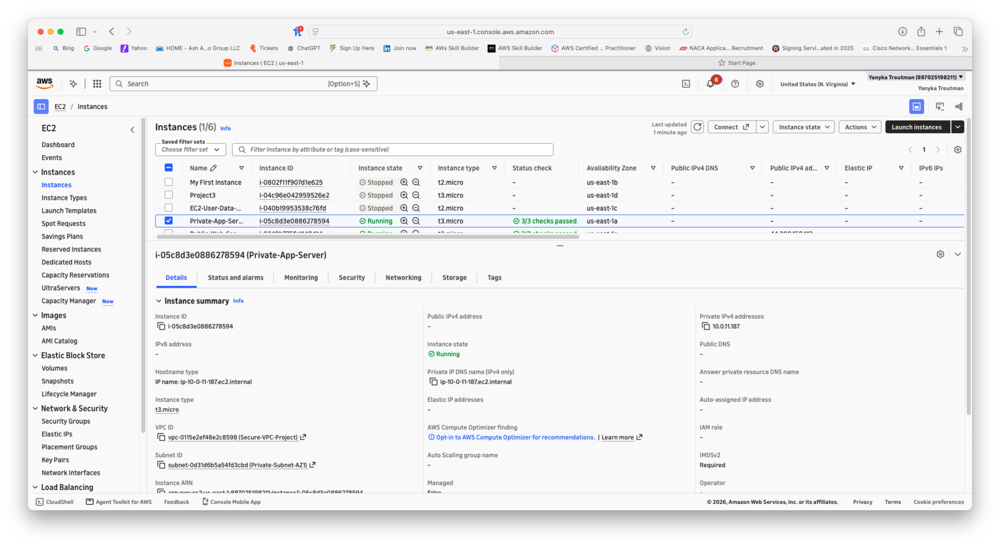

### 13. Validated Network Segmentation

The public server received a public IPv4 address while the private server remained isolated from direct internet access.

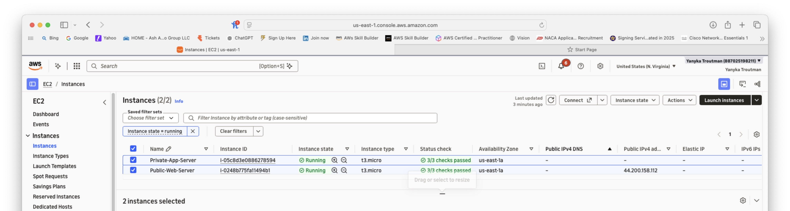

### 14. Configured NAT Gateway Routing

A NAT Gateway was configured to allow resources in the private subnet to initiate outbound internet connections without exposing them directly to inbound internet traffic.

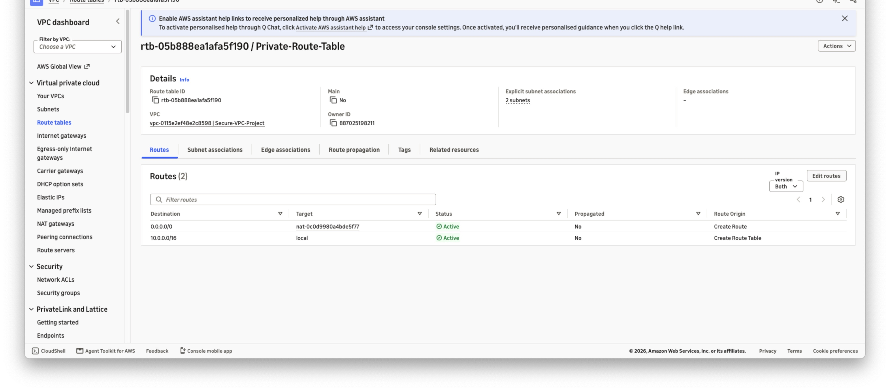

## Key Takeaways

Through this project, I gained hands-on experience with:

- Designing custom AWS VPC address space
- Creating public and private subnets
- Deploying resources across Availability Zones
- Configuring Internet Gateway and NAT Gateway connectivity
- Managing public and private route tables
- Controlling traffic with security groups
- Separating public and private workloads
- Validating network connectivity and isolation
- Documenting cloud architecture

## Business Value

Separating public-facing and private application resources reduces unnecessary exposure and provides greater control over network traffic.

This type of segmented VPC design provides a strong foundation for secure and scalable cloud applications where only required resources are directly accessible from the internet.

## Skills Demonstrated

`AWS` `Amazon VPC` `EC2` `Networking` `CIDR` `Subnets` `Route Tables` `Internet Gateway` `NAT Gateway` `Security Groups` `Network Segmentation` `Cloud Security` `Solution Architecture`
